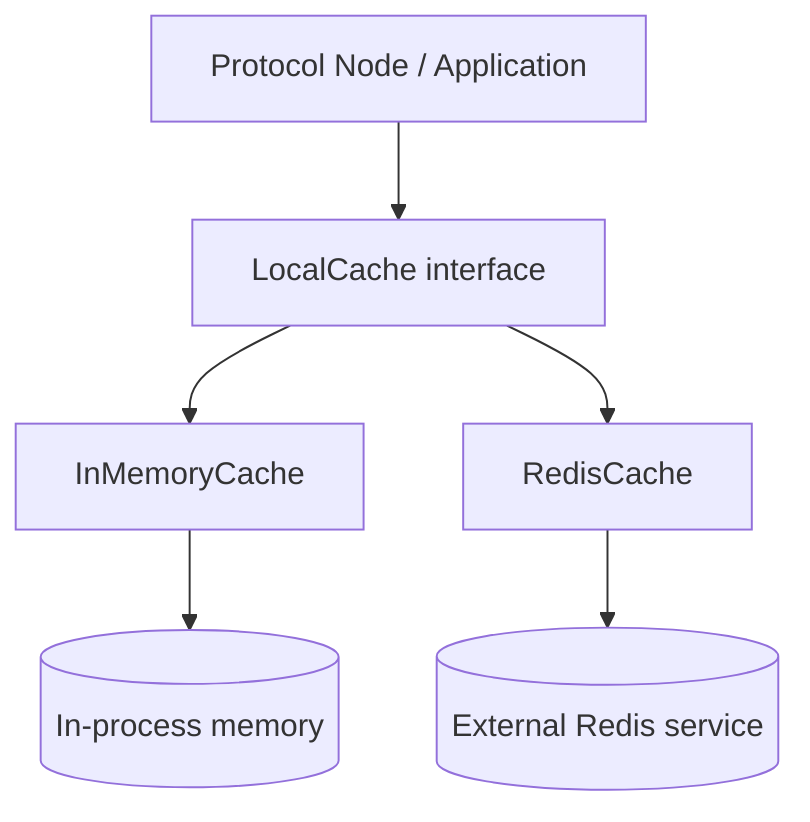

# Cache 模块调用关系（Mermaid）

下面的关系图仅聚焦缓存层，展示协议节点如何通过统一接口切换不同后端。



- LocalCache 统一 `put/get/del/exists/flush` 语义，屏蔽后端差异。
- InMemoryCache 轻量、无依赖，适合单机和测试。
- RedisCache 通过 redis-plus-plus 连接外部 Redis；代码不负责启动 Redis，需要提前部署。
- RedisCache 直接操作原始 key，不添加前缀；如需命名空间隔离，请在 key 中自行编码。

---

## Draw.io 绘制步骤（照此复刻上图）

> 建议保存为：`docs/cache-architecture.drawio`；并导出 `docs/cache-architecture.png` 方便引用。

### 给绘图 AI 的精确描述（可直接复制）

请在 draw.io 里绘制一张"缓存层架构/调用关系"图（对应上方 Mermaid），要求：
- 画布：纵向（或任意但整体自上而下），宽 `1200` 高 `900`，白底 `#FFFFFF`；字体 `Inter/Helvetica` 12。
- 节点：
  - 顶部：`Protocol Node / Application`
  - 第二层：`LocalCache interface`
  - 第三层左右并列：`InMemoryCache`、`RedisCache`
  - 第四层对应后端：`In-process memory`（存储形状）、`External Redis service`（存储形状）
- 连线：
  - 实线箭头表示调用：`App -> LocalCache -> (InMemoryCache, RedisCache)`，以及实现到后端。

可按下面规格清单放置（坐标单位 px，允许 ±10px 微调）：

```yaml
canvas:
  width: 1200
  height: 900
  background: "#FFFFFF"
style:
  font: "Inter"
  fontSize: 12
  strokeWidth: 1.5
colors:
  moduleFill: "#F5F5F5"
  moduleStroke: "#6B7280"
  storeFill: "#FFF7ED"
  storeStroke: "#9A3412"
nodes:
  - {id: app, label: "Protocol Node / Application", x: 420, y: 60,  w: 360, h: 56, shape: "roundRect"}
  - {id: lc,  label: "LocalCache interface",        x: 420, y: 160, w: 360, h: 56, shape: "roundRect"}
  - {id: imc, label: "InMemoryCache",               x: 220, y: 280, w: 320, h: 56, shape: "roundRect"}
  - {id: rc,  label: "RedisCache",                  x: 660, y: 280, w: 320, h: 56, shape: "roundRect"}
  - {id: mem, label: "In-process memory",           x: 220, y: 400, w: 320, h: 80, shape: "database"}
  - {id: redis, label: "External Redis service",    x: 660, y: 400, w: 320, h: 80, shape: "database"}
edges:
  - {from: app, to: lc,    dashed: false}
  - {from: lc,  to: imc,   dashed: false}
  - {from: lc,  to: rc,    dashed: false}
  - {from: imc, to: mem,   dashed: false}
  - {from: rc,  to: redis, dashed: false}
```

### 1）画布与样式

1. 新建图：**Flowchart** → 空白画布；页面建议 A4 或 16:9，纵向（TD 更自然）。
2. 形状与样式建议：
   - “模块/类”：圆角矩形（浅灰填充）
   - “外部服务/存储”：圆柱体（Database 形状）
   - 连接线：
     - 实线箭头：调用/依赖
     - 虚线箭头：约束/语义（例如 prefix isolation）

### 2）放置节点（自上而下）

从上到下依次放置，并保持居中对齐：
- 顶部：`Protocol Node / Application`
- 第二层：`LocalCache interface`
- 第三层（左右并列）：`InMemoryCache`、`RedisCache`
- 底部（对应实现的后端）：
  - `InMemoryCache` 下方：`In-process memory`
  - `RedisCache` 下方：`External Redis service`

### 3）连线与标注

按以下关系连线：
- `Protocol Node / Application` → `LocalCache interface`
- `LocalCache interface` → `InMemoryCache`
- `LocalCache interface` → `RedisCache`
- `InMemoryCache` → `In-process memory`
- `RedisCache` → `External Redis service`

### 4）检查点（避免画错）

- `LocalCache interface` 必须作为"统一入口"，上游只连它，不要直接连到具体实现。
