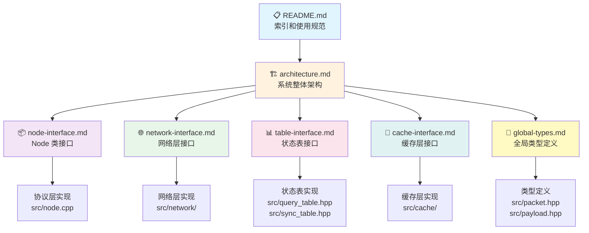

# 接口设计文档

> **版本**: v0.3.0
> **最后更新**: 2026-01-19
> **状态**: 正式版

---

## 概述

本目录包含 rsync 项目的接口设计文档，用于协调多开发者之间的代码编写。**所有接口变更必须先更新文档，再实现代码。**

### 整体视图



### 快速导航

| 我想... | 阅读文档 | 跳转 |
|---------|---------|------|
| 🎯 **理解系统整体设计** | architecture.md | [→ 查看](./architecture.md) |
| 📦 **了解 Node 类接口** | node-interface.md | [→ 查看](./node-interface.md) |
| 🌐 **了解网络层接口** | network-interface.md | [→ 查看](./network-interface.md) |
| 📊 **了解状态表接口** | table-interface.md | [→ 查看](./table-interface.md) |
| 💾 **了解缓存层接口** | cache-interface.md | [→ 查看](./cache-interface.md) |
| 🔧 **了解全局类型定义** | global-types.md | [→ 查看](./global-types.md) |
| 🤔 **解决接口冲突** | 当前待解决冲突 | [→ 查看](#当前待解决冲突) |
| 📝 **更新文档** | 贡献指南 | [→ 查看](#贡献指南) |

### 文档层次结构

```
docs/interfaces/
│
├── 📋 README.md ..................... 你在这里
│   ├── 整体视图
│   ├── 快速导航
│   └── 使用规范
│
├── 🏗️ architecture.md ............... 必读！系统整体架构
│   ├── 系统层次结构
│   ├── 模块职责
│   ├── 数据流
│   ├── 关键设计决策
│   └── 配置文件格式
│
├── 📦 node-interface.md ............. Node 类接口
│   ├── 公共接口（requestFile, processOne）
│   ├── 私有接口（handleRequest, handleData）
│   └── 使用示例
│
├── 🌐 network-interface.md .......... 网络层接口
│   ├── 核心方法（send_direct, broadcast）
│   ├── 实现类（MockNetwork, TCPNetwork）
│   └── 配置文件格式
│
├── 📊 table-interface.md ............ 状态表接口
│   ├── QueryTable（请求跟踪）
│   ├── SyncTable（数据位置）
│   └── LRU 淘汰策略
│
├── 💾 cache-interface.md ............ 缓存层接口
│   ├── LocalCache 接口
│   ├── RedisCache 实现
│   └── InMemoryCache 实现
│
└── 🔧 global-types.md ............... 全局类型定义
    ├── PacketType 枚举
    ├── Packet 结构
    ├── BloomFilter 类
    └── 全局常量
```

---

## 文档索引

| 文档 | 职责 | 状态 | 维护者 |
|------|------|------|--------|
| [architecture.md](./architecture.md) | **系统整体架构** | ✅ 已完成 | KE RUI |
| [node-interface.md](./node-interface.md) | Node 类公共接口 | 🔄 编写中 | KE RUI |
| [network-interface.md](./network-interface.md) | 网络层抽象接口 | 🔄 编写中 | KE RUI |
| [table-interface.md](./table-interface.md) | SyncTable/QueryTable 接口 | 🔄 编写中 | 另一位开发者 |
| [cache-interface.md](./cache-interface.md) | 缓存层接口 | 🔄 编写中 | KE RUI |
| [global-types.md](./global-types.md) | 全局类型和常量 | 🔄 编写中 | 共同维护 |

---

## 快速开始

### 1. 开发前必读

在编写代码前，请按顺序阅读：
1. **[architecture.md](./architecture.md)** - 理解系统整体设计
2. **对应模块的接口文档** - 理解具体接口规范
3. **[global-types.md](./global-types.md)** - 理解全局类型定义

### 2. 接口变更流程

```
发现需求 → 更新文档 → 团队审查 → 实现代码 → 更新版本号
```

**重要**: 禁止"先写代码，后补文档"的做法。

### 3. 冲突解决流程

当两个开发者对同一接口有不同理解时：

1. **记录冲突**: 在对应文档中添加 `## 待讨论` 章节
2. **描述方案**: 记录双方的设计方案和理由
3. **会议讨论**: 基于文档讨论，达成共识
4. **更新文档**: 标记为 `已解决`，更新版本号
5. **实现代码**: 严格按照文档实现

---

## 使用规范

### 文档格式要求

每个接口文档必须包含：

- **版本信息**: 版本号、更新日期、状态
- **接口签名**: 方法名、参数类型、返回值类型
- **功能描述**: 做什么，不做什么
- **前置条件**: 调用前必须满足的条件
- **后置条件**: 调用后保证的状态
- **异常情况**: 错误处理方式
- **使用示例**: 代码片段
- **变更历史**: 版本、日期、变更内容

### 版本管理规则

- **主版本号 (X.0.0)**: 不兼容的接口变更（如删除方法、修改参数类型）
- **次版本号 (0.X.0)**: 向后兼容的功能新增（如新增方法、新增可选参数）
- **修订号 (0.0.X)**: 向后兼容的问题修正（如文档更新、注释修正）

**示例**:
- `v0.1.0 → v0.2.0`: 新增 `send_direct()` 方法
- `v0.2.0 → v1.0.0`: 删除 `neighbors_` 成员变量
- `v1.0.0 → v1.0.1`: 修正文档中的错别字

---

## 当前待解决冲突

### 冲突 1: Node 是否持有 neighbors_？

**状态**: ✅ 已解决 (2026-01-16)

**决策**: 删除 `neighbors_` 成员变量，使用 `network_->broadcast()` 和 `network_->send_direct()`

**理由**: 见 [architecture.md](./architecture.md) 第 4.1 节

---

### 冲突 2: SyncTable 存储 BloomFilter 还是精确文件名？

**状态**: ✅ 已解决 (2026-01-08)

**决策**: 存储精确文件名 + LRU 淘汰

**理由**: 见 [architecture.md](./architecture.md) 第 4.3 节

---

### 冲突 3: QueryTable 是单源还是多源？

**状态**: ✅ 已解决 (2026-01-08)

**决策**: 单源（每个请求只记录一个下游节点）

**理由**: 见 [architecture.md](./architecture.md) 第 4.4 节

---

## 快速参考

### Node 核心方法

```cpp
// 发起文件请求
void requestFile(const std::string& key);

// 处理一个数据包
void processOne();

// 添加本地数据
void addLocalData(const std::string& key, const std::string& value);
```

### NetworkInterface 核心方法

```cpp
// 发送给指定节点
void send_direct(uint32_t dest_node_id, std::unique_ptr<Packet> pkt);

// 广播给所有邻居
void broadcast(std::unique_ptr<Packet> pkt);

// 接收数据包
std::unique_ptr<Packet> receive();

// 配置拓扑
void configure_topology(const std::string& config_file_path, uint32_t my_node_id);

// 获取邻居列表
std::vector<uint32_t> get_neighbors() const;
```

### SyncTable 核心方法

```cpp
// 记录文件位置
void set(uint32_t node_id, const std::string& filename);

// 查询文件位置
std::optional<uint32_t> lookup(const std::string& filename);
```

### QueryTable 核心方法

```cpp
// 记录待处理请求
void addPending(uint64_t request_id, uint32_t downstream_node);

// 查询并移除
std::vector<uint32_t> getAndRemove(uint64_t request_id);
```

---

## 贡献指南

### 如何更新文档？

1. **Fork 或创建分支**: 在 Git 中创建功能分支
2. **修改文档**: 更新对应的 Markdown 文件
3. **更新版本号**: 根据变更类型更新版本号
4. **提交 PR**: 提交 Pull Request，等待审查
5. **合并**: 审查通过后合并到主分支

### 文档审查清单

- [ ] 接口签名是否清晰？
- [ ] 参数和返回值是否有详细说明？
- [ ] 是否包含使用示例？
- [ ] 是否更新了变更历史？
- [ ] 是否更新了版本号？
- [ ] 是否与代码实现一致？

---

## 相关资源

- **代码仓库**: `/home/ifzzh/Documents/NetOS/meeting-records/design/code/rsync/`
- **会议记录**: `/home/ifzzh/Documents/NetOS/meeting-records/`
- **设计文档**: `/home/ifzzh/Documents/NetOS/meeting-records/design/README.md`
- **根级文档**: `/home/ifzzh/Documents/NetOS/meeting-records/CLAUDE.md`

---

**下一步**: 阅读 [architecture.md](./architecture.md) 了解系统整体设计
