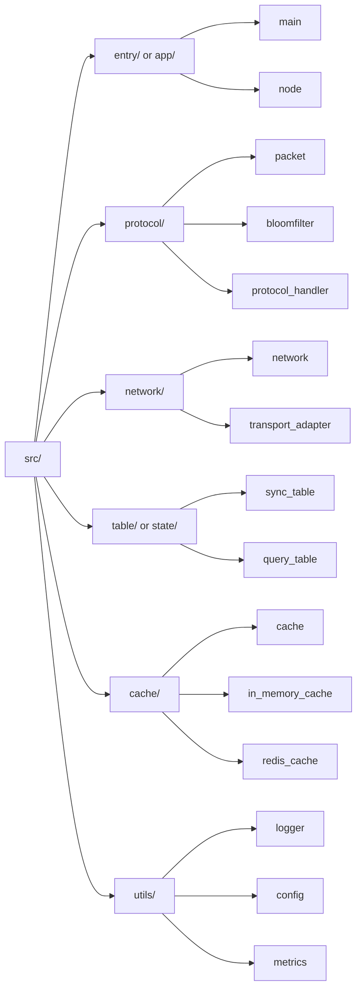

# Source Layout (Mermaid Overview)

项目内建议的 `src/` 目录组织示意（便于分层解耦与替换实现）：



**层级说明**：
- **第一层**：`src/` 根目录
- **第二层**：功能模块（目录或直接文件）
- **第三层**：具体文件（抽象表示，不含后缀）

**模块职责**：
- `entry/` / `app/`：进程入口与依赖装配（main、node 等）
- `protocol/`：同步协议核心（packet 定义、bloomfilter、协议处理器）
- `network/`：传输层抽象与适配器（TCP/UDP/QUIC 等）
- `table/` / `state/`：核心状态表（sync_table、query_table）
- `cache/`：`LocalCache` 接口及实现（in_memory_cache、redis_cache）
- `utils/`：通用工具（logger、config、metrics 等）

**注**：第三层文件为抽象示意，不与当前实现一一对应，表达应有的分层结构。  

---

## Draw.io 绘制步骤（照此复刻上图）

> 建议保存为：`docs/src-structure.drawio`；并导出一份 `docs/src-structure.png` 便于在 README/汇报中引用。

### 给绘图 AI 的精确描述（可直接复制）

请在 draw.io 里绘制一张“源码分层结构”图（对应上方 Mermaid），要求：
- 画布：16:9 横向，宽 `1600` 高 `900`，白底 `#FFFFFF`，开启网格与对齐吸附。
- 字体：`Inter/Helvetica`，字号 `12`；所有节点使用圆角矩形。
- 三列布局（左→右）：`src/` 根节点 → 六个模块目录 → 每个模块的代表文件/概念节点。
- 连线：全部为左→右的单向箭头（不要双向），避免交叉；模块与其子节点垂直等距。

可按下面规格清单放置（坐标单位 px，允许 ±10px 微调）：

```yaml
canvas:
  width: 1600
  height: 900
  background: "#FFFFFF"
style:
  font: "Inter"
  fontSize: 12
  strokeWidth: 1.5
colors:
  dirFill: "#E8F2FF"
  dirStroke: "#5B7AA6"
  leafFill: "#F5F5F5"
  leafStroke: "#888888"
layout:
  # 三列 x 坐标
  x:
    root: 80
    module: 420
    leaf: 900
  # 节点尺寸
  size:
    root:  {w: 200, h: 56}
    module:{w: 320, h: 56}
    leaf:  {w: 260, h: 52}
nodes:
  - {id: src, label: "src/",             col: root,   y: 120, kind: dir}
  - {id: entry, label: "entry/ or app/", col: module, y: 60,  kind: dir}
  - {id: proto, label: "protocol/",      col: module, y: 180, kind: dir}
  - {id: net,   label: "network/",       col: module, y: 300, kind: dir}
  - {id: state, label: "table/ or state/", col: module, y: 420, kind: dir}
  - {id: cache, label: "cache/",         col: module, y: 540, kind: dir}
  - {id: utils, label: "utils/",         col: module, y: 660, kind: dir}
  # entry leaves
  - {id: entry_main, label: "main", col: leaf, y: 30,  kind: leaf}
  - {id: entry_node, label: "node", col: leaf, y: 90,  kind: leaf}
  # protocol leaves
  - {id: p_packet,  label: "packet",           col: leaf, y: 150, kind: leaf}
  - {id: p_bf,      label: "bloomfilter",      col: leaf, y: 210, kind: leaf}
  - {id: p_handler, label: "protocol_handler", col: leaf, y: 270, kind: leaf}
  # network leaves
  - {id: n_network,    label: "network",           col: leaf, y: 310, kind: leaf}
  - {id: n_transport,  label: "transport_adapter", col: leaf, y: 370, kind: leaf}
  # state leaves
  - {id: s_sync,  label: "sync_table",  col: leaf, y: 430, kind: leaf}
  - {id: s_query, label: "query_table", col: leaf, y: 490, kind: leaf}
  # cache leaves
  - {id: c_if,  label: "cache",           col: leaf, y: 550, kind: leaf}
  - {id: c_imc, label: "in_memory_cache", col: leaf, y: 610, kind: leaf}
  - {id: c_rc,  label: "redis_cache",     col: leaf, y: 670, kind: leaf}
  # utils leaves
  - {id: u_log,    label: "logger",  col: leaf, y: 710, kind: leaf}
  - {id: u_config, label: "config",  col: leaf, y: 770, kind: leaf}
  - {id: u_metrics,label: "metrics", col: leaf, y: 830, kind: leaf}
edges:
  - {from: src, to: entry}
  - {from: src, to: proto}
  - {from: src, to: net}
  - {from: src, to: state}
  - {from: src, to: cache}
  - {from: src, to: utils}
  - {from: entry, to: entry_main}
  - {from: entry, to: entry_node}
  - {from: proto, to: p_packet}
  - {from: proto, to: p_bf}
  - {from: proto, to: p_handler}
  - {from: net, to: n_network}
  - {from: net, to: n_transport}
  - {from: state, to: s_sync}
  - {from: state, to: s_query}
  - {from: cache, to: c_if}
  - {from: cache, to: c_imc}
  - {from: cache, to: c_rc}
  - {from: utils, to: u_log}
  - {from: utils, to: u_config}
  - {from: utils, to: u_metrics}
```

### 1）画布与样式（一次设置，全图复用）

1. 打开 draw.io（diagrams.net）→ **Create New Diagram** → 选择 **Flowchart** 或 **Blank Diagram**。
2. 右侧 **Format panel**：
   - **Page**：A4（或 16:9），**Landscape**（横向）
   - **Grid**：开启；便于对齐与等距分布
   - **Style（建议）**：
     - 目录节点：圆角矩形、浅蓝填充（例：`#E8F2FF`）、边框蓝灰（例：`#5B7AA6`）
     - 文件/概念节点：圆角矩形、浅灰填充（例：`#F5F5F5`）、边框灰（例：`#888888`）
     - 连接线：单向箭头（`endArrow=block`），线宽 1.5

### 2）放置节点（从左到右）

按 Mermaid 的层级放置三列（左→右）：

**第一列（根）**
- `src/`

**第二列（模块目录）**
- `entry/ or app/`
- `protocol/`
- `network/`
- `table/ or state/`
- `cache/`
- `utils/`

**第三列（每个模块的代表文件/概念）**
- `entry/ or app/` 下：`main`、`node`
- `protocol/` 下：`packet`、`bloomfilter`、`protocol_handler`
- `network/` 下：`network`、`transport_adapter`
- `table/ or state/` 下：`sync_table`、`query_table`
- `cache/` 下：`cache`、`in_memory_cache`、`redis_cache`
- `utils/` 下：`logger`、`config`、`metrics`

### 3）连线（严格按依赖/包含关系）

用单向箭头按如下关系连接（方向左→右）：
- `src/` → 六个模块目录
- 每个模块目录 → 其对应的第三层节点

### 4）排版与检查

1. 选中同一列的节点 → **Arrange → Align**（左对齐/上对齐）→ **Arrange → Distribute**（垂直等距）。
2. 确保所有连线不交叉（必要时把第三列节点稍微上下错开）。
3. 最后给 `src/` 节点加粗或加深颜色，让“入口”更突出。
